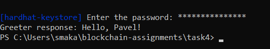

# Task 4 — Blockchain Practicalities: Ethereum Basics

## Part 1 Install Hardhat

**Answer 1 Contract Deployment Transaction**

https://sepolia.basescan.org/tx/0xc173b6ed0abe4984e95ad482ae90aed4bbc1c8d98b20c733aa6948ff16ee69cd

## Part 2 Create and Deploy Your First Smart Contract

**Answer 1 Greeter Contract Deployment Transaction**

[https://sepolia.basescan.org/tx/0xf455ee1acb9dcad91e7ae227e9d8a605d7973fc52540f4172037be5e202753a6](https://sepolia.basescan.org/tx/0xf455ee1acb9dcad91e7ae227e9d8a605d7973fc52540f4172037be5e202753a6)

